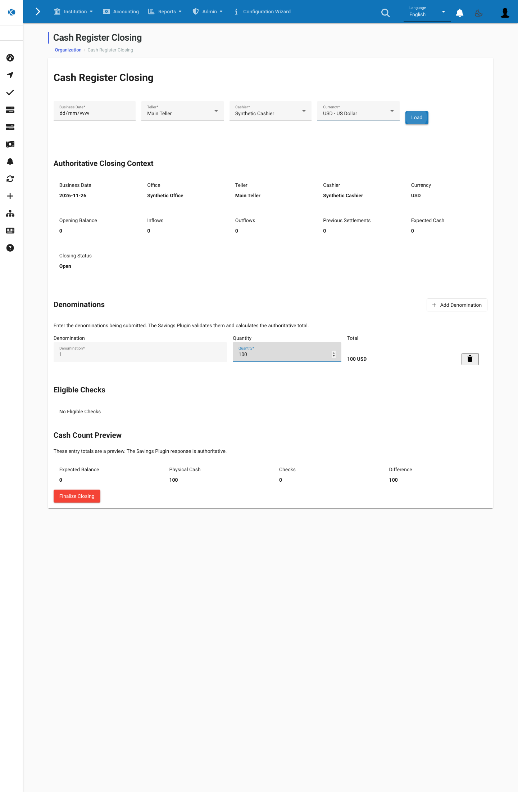
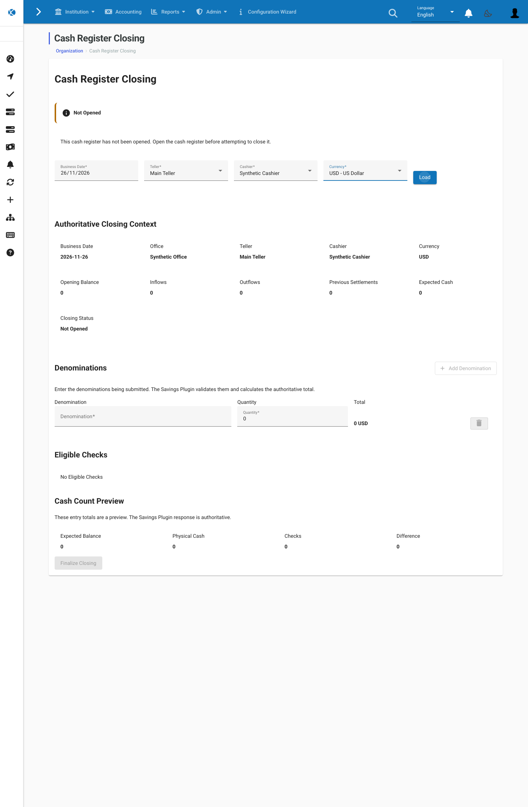
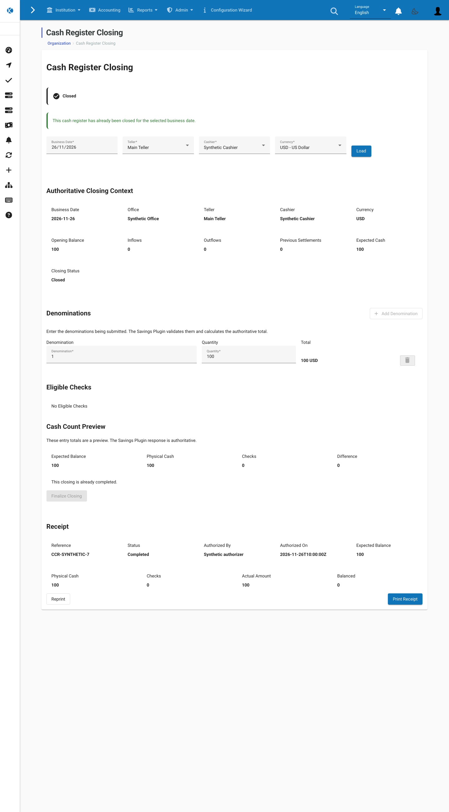

# WEB-1493 cash register closing

A register without a reconciliation was previously returned as `OPEN`, even when no opening existed. The closing command checked only whether a reconciliation already existed. A zero-cash declaration could therefore create a completed closing for an unopened register.

The companion Savings Plugin change verifies the completed opening/provisioning allocation before closing. This frontend consumes that evidence, revalidates after confirmation, and keeps an authoritative completed receipt visible during status refreshes.

## Deployment and API contract

Deploy the companion Savings Plugin branch `fix/WEB-1493-cash-register-closing-validation` before this frontend. Both branches are based on upstream `develop` / `dev` respectively. No database migration or new endpoint is required.

Existing endpoints remain:

- `GET /v2/base-teller/closings/context?cashierId=3&currencyCode=USD&businessDate=2026-11-26`
- `POST /v2/base-teller/closings`
- `GET /v2/base-teller/closings/{id}`

The context adds `registerStatus` and `closingId`:

| registerStatus | Meaning | Closing permitted |
| --- | --- | --- |
| `NOT_OPENED` | No qualifying completed opening for this scope | No |
| `OPEN` | Verified opening, no completed closing | Yes, subject to permissions, unchanged context and valid inputs |
| `COMPLETED` | Persisted completed reconciliation; `closingId` identifies its receipt | No |
| Missing, unsupported or malformed evidence | Display Status Unavailable | No |

The existing shared `status: OPEN | COMPLETED` remains compatible for deposits and holdings. It is not opening eligibility. An older backend without `registerStatus` intentionally cannot enable this closing screen.

Opening eligibility comes from a completed `HEAD_CASHIER_ALLOCATION` or `OPERATIONAL_TELLER_ALLOCATION` in the current tenant database, with the same destination cashier, office, business date and currency and a matching native allocation transaction. Opening allocation amounts must be positive in the existing workflow; the remaining balance may legitimately be zero. Neither balances, inflows, assignment nor missing reconciliation establish eligibility. The current opening workflow has no carry-forward or allocation reversal operation; non-completed/cancelled/reversed records do not qualify.

End-of-Day Closing remains a register-wide reconciliation of every configured currency, including unused currencies. Its common posting boundary verifies a completed register opening rather than requiring an opening allocation in every unused currency.

The structured unopened rejection is `error.msg.base.teller.closing.not.opened`. Existing permission, office hierarchy, separate authorizer, business date, fingerprint and receipt access checks remain enforced. Matching authorized replay can return an existing receipt after the business date changes.

## Implementation

- `cash-management.models.ts`: closing-specific status and receipt lookup ID, without expanding shared operation status values.
- `cash-management.component.ts`: one eligibility guard for buttons and methods; immutable confirmation snapshot; authoritative GET immediately before POST; duplicate-dialog/submission guards; stale-response protection; completed-receipt preservation; session-scoped unresolved request identity and declarations. Unknown financial outcomes are reconciled using GETs and never automatically resent. Explicit unopened/already-completed domain rejections refresh context without showing success.
- `cash-management.component.html` and `.scss`: accessible persistent Not Opened / Open / Closed / Status Unavailable indicator, read-only closing controls and explanations, semantic light/dark styling, existing blue primary theme and receipt printing.
- All 14 translation catalogs: new localized status and recovery messages, plus remaining relevant terminology corrections from the original review.
- Service and component Jest tests; isolated Playwright fixtures/configuration. The original native-date formatting and history paginator review findings are also corrected in the shared component.

The backend also fixes a JDBC `RowCallbackHandler` that incorrectly called `next()` and skipped the first transaction group. Database regressions now assert both a funded expected balance and an opened register whose remaining balance is zero.

## Verification on 26 November 2026

| Check | Result |
| --- | --- |
| Focused Jest: component, service, route guard | 68 passed |
| Playwright closing workflow | 12 passed; synthetic HTTP fixtures, no live financial POSTs |
| `npm run build` | Passed; existing dependency/CSS warnings |
| `npm run lint` | Passed |
| `npm run headers:add` and `headers:check` with file arguments | Passed |
| `npm run translations:extract` | Passed; extraction markers cover dynamic statuses and errors |
| Savings Plugin `mvn verify` with focused database integration suites | 970 unit tests and 39 PostgreSQL integration tests passed, coverage checks passed; JAR built |
| Spotless on changed Java files | Passed |
| Repository-wide Spotless | Fails on unrelated upstream formatting; reproduced against unmodified `7f31cd2` |

Database tests use PostgreSQL Testcontainers, the real reconciliation Liquibase migrations, transactions, locks and uniqueness constraints. They cover never-opened zero-cash commands, zero remaining balance, mismatched scopes, non-completed openings, permissions, self-authorization, duplicate commands, concurrent distinct keys, matching concurrent replay under a repeatable-read caller, historical replay and rollback without reconciliation/native-settlement side effects. Native Fineract command execution is mocked at the command boundary, with settlement rows written into the test transaction.

## Browser evidence

These are synthetic fixture screenshots, not proof of live Fineract accounting or production deployment. The before image uses the unchanged upstream closing component and demonstrates the misleading Open state and enabled Finalize Closing action. The after images use this branch.

## Review and remaining release validation

Reviewed [web-app #4050](https://github.com/openMF/web-app/pull/4050) and [Savings Plugin #107](https://github.com/openMF/savings-plugin/pull/107), their original implementation commits, conversation and review history. The frontend received maintainer approval; the backend history contains the CodeRabbit review-skipped notice and no actionable maintainer review. Historical safeguards for failed-operation retry routing, stale selection invalidation, idempotency rotation and immutable unresolved payloads are preserved and tested. Relevant interpolation and terminology findings are retained/corrected across catalogs. The follow-up Retry finding is also fixed: mismatched or malformed context responses register a context GET recovery action, Retry is hidden when no action exists, and no-action calls preserve the error. Jest and browser regressions verify recovery without a financial POST. No new maintainer approval is implied.

There is no running Fineract service at the local test endpoint. The full live opening → context → closing → receipt → reload exercise and native general-ledger posting still require a safe deployed backend. Maintainers also require manually captured before/after screenshots; the supplied automated screenshots supplement that requirement. Do not mark WEB-1493 resolved on the strength of a frontend deployment alone.

Compare or prepare pull requests:

- [Frontend comparison](https://github.com/openMF/web-app/compare/dev...AnvayKharb:fix/WEB-1493-cash-register-closing-validation?expand=1)
- [Companion backend comparison](https://github.com/openMF/savings-plugin/compare/develop...AnvayKharb:fix/WEB-1493-cash-register-closing-validation?expand=1)
